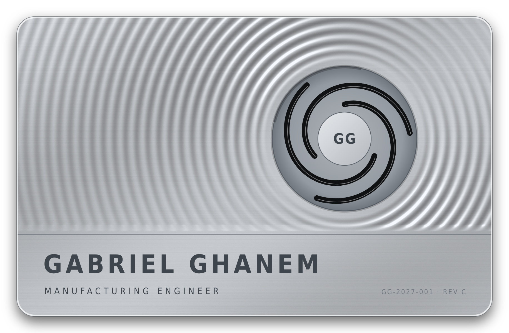
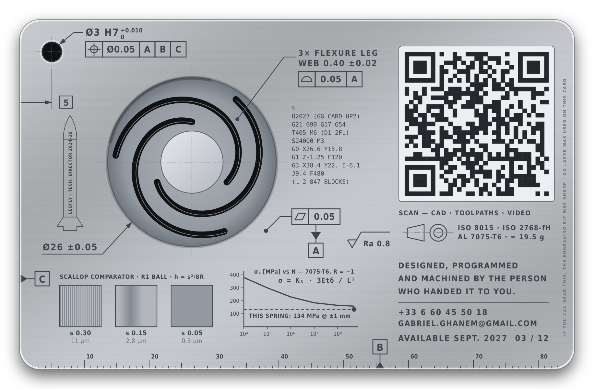

# CNC Business Card

A CNC-milled aluminium business card with a working orthoplanar spring, designed and machined by Gabriel Ghanem.

The card is a PLM demo in the hand: part number, revision, serial, and a QR code that opens its digital twin (CAD model, toolpaths, machining video).

## Spec (rev A, draft)

| | |
|---|---|
| Format | ISO ID-1, 85.60 × 53.98 mm, corner radius 3.18 mm |
| Stock | 2 mm aluminium plate, 7075-T6 for the flexure |
| Finished thickness | 1.70 mm: 0.15 mm faced off each side before engraving (v3) |
| Faces | Engraved recto and verso (flip with dowel-pin registration) |
| Flexure | Orthoplanar spring, 3 spiral legs, Ø26 mm pocket, web 0.40 mm centred in the thickness (recess 0.65 mm from each finished face) |
| QR | Points to the GitHub Pages site served from `docs/` (final short URL to be decided before engraving) |

## Flexure sizing (first pass)

`analysis/flexure_fatigue.py` treats each leg as a fixed-guided beam with a 1.4 knock-down for fillets, torsion and surface finish. Results are in `analysis/flexure_fatigue_results.txt`.

- Chosen point: 7075-T6, web 0.40 mm, leg length about 30 mm, leg width 2.6 mm.
- At ±1 mm travel the stress is about 134 MPa, under the 5×10⁸-cycle fatigue strength (159 MPa).
- At 3 mm of abuse it reaches about 400 MPa, under yield (503 MPa), so a finger should not bend it permanently.
- 6061-T6 yields under the same abuse case, so it is kept for cards without a flexure or for test cuts.
- To confirm by FEA (curved legs) and by cycling a test coupon before the batch.

## Layout

| Folder | Contents |
|---|---|
| `design/mockups/` | Concept mockups (SVG + PNG) and the script that generates them |
| `analysis/` | Flexure sizing |
| `cad/` | CAD exports (STEP, DXF) |
| `cam/` | Toolpaths, setup sheets, feeds and speeds |
| `docs/` | The page the QR code opens |
| `media/` | Photos and videos of the machining |

## Current concept: v2

Ripple recto, technical verso. Generated by `design/v2/generate.py`; the ripple is a real height field (wavelength 2.0 mm, amplitude 0.12 mm) that can be exported for 3D contouring.

| Recto | Verso |
|---|---|
|  |  |

Rule for the verso: every callout is a true, checkable statement about the card (Ø3 H7 hole, datums, web thickness, scallop heights, S-N operating point).

To verify before engraving: S-N data against a referenced source, mass on a scale, G-code excerpt replaced by lines from the real program, final QR URL.

## 3D model

`cad/build_card.py` builds the card with CadQuery from the same layout as the mockup. Frame: X along the long edge, Y up as seen from the recto, Z = 0 on the finished verso (datum A), Z = 1.70 on the finished recto.

Two versions are kept:

- **v3 (current, 1.70 mm):** both faces are surfaced by 0.15 mm before engraving. Files `card_v3_*` and `engraving_v3_*`.
- **v2 (2.00 mm, unsurfaced):** the geometry of the first test card and of the Fusion test CAM. Files `card_v2_*`, `engraving_*_model.dxf`.

| File (v3) | Use |
|---|---|
| `cad/card_v3_body.step` | Machining geometry: outline, chamfer, ripple surface, spring recesses and slots, hole. No engraving. |
| `cad/engraving_v3_recto_model.dxf`, `cad/engraving_v3_verso_model.dxf` | Engraving contours in model coordinates, for CAM. |
| `cad/engraving_v3_recto.dxf`, `cad/engraving_v3_verso_as_viewed.dxf` | The same contours drawn as you look at each face. |
| `cad/card_v3_engraved.stl` | Visual mock-up with the engraving cut as flat pockets. |
| `design/v2/3d/` | Renders of the v3 mock-up. |

Z stack of v3, measured from the finished faces:

| Zone | Recto cut | Verso cut | Material left |
|---|---|---|---|
| Ripple field | 0.14 max (0.02 step + 0.12 ripple) | V-carve, 0.02 to 0.15 for text | 1.41 or more |
| Under the QR finder squares | 0.14 max | V-carve to 1.05 | 0.51 |
| Name band | V-carve | V-carve | depends on stroke width |
| Spring recess | 0.65 | 0.65 | 0.40 web, nothing engraved on it |
| Boss | "GG" | none | about 1.5 |

- Mass 19.5 g in 7075 (computed).
- The flexure sizing is unchanged: it only depends on the 0.40 mm web.
- The ripple's tightest concave radius is 1.69 mm, so any ball nose up to R1.5 follows it.

## Test CAM (Fusion, project "Business card", document "Card v2")

This CAM is for the first test card on the v2 geometry (2.00 mm, no surfacing). It has not been moved to v3.

`cad/export_cam_inputs.py` writes what Fusion needs: the body STEP and the engraving contours in model coordinates (now the v3 files; the test CAM used `card_v2_body.step`, `engraving_verso_model.dxf` and `engraving_recto_model.dxf`). The comparator patches are left out of the verso contours; they are surfaced with ball mills.

Setup "OP1 - Verso": verso up, WCS at the stock top centre (= card centre), X along the long edge, stock 105.6 x 73.98 x 2 (10 mm margin).

| Operation | Tool | Depth | Time |
|---|---|---|---|
| Spring recess, 2D pocket | T20, 2 mm flat | 0.80 in two passes | 73 s |
| Hole, helical bore to diameter 3 | T20 | through, 0.08 below the stock | 2 s |
| Engraving, V-carve | T43, 90 degree | 0.05 to 1.05 (deepest in the QR finder squares) | 25 min |

`cad/verify_nc.py` replays the posted G-code against the design: the V never leaves the artwork (overcut under 0.01 mm), the pocket tool stays between r 5.8 and 12.0, and no rapid moves in XY below Z0.

Not programmed yet: comparator patches, outline and chamfer, reaming the hole to H7, the whole recto side.

Note: the ripple field sits 0.02 mm below the raw recto face so the crests are machined too.

## Earlier concepts (v1)

Three first directions are kept in `design/mockups/`: A drawing sheet, B ripple, C digital thread.
