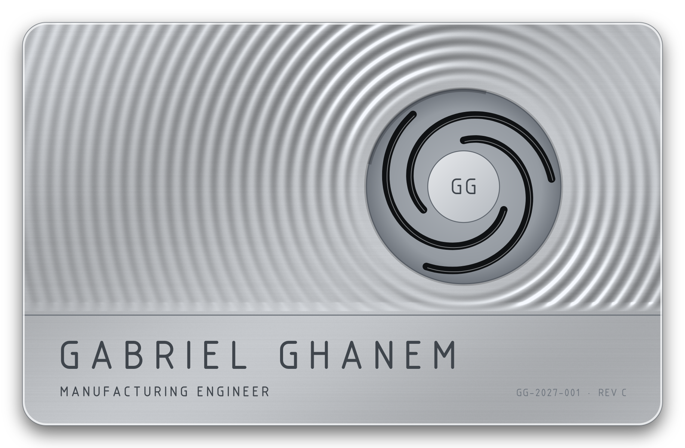
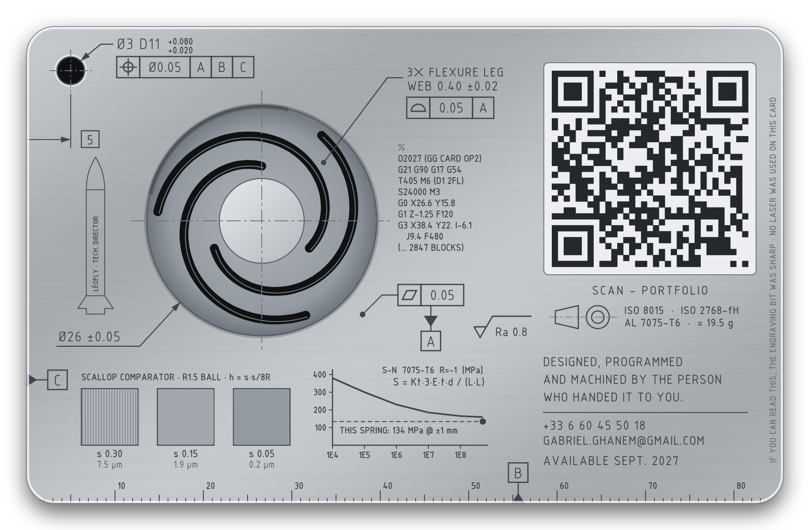

# CNC Business Card

A CNC-milled aluminium business card with a working orthoplanar spring, designed and machined by Gabriel Ghanem.

The card is a PLM demo in the hand: part number, revision, and a QR code that opens the portfolio page in `docs/` (how the card was made, other work, contact).

## Spec (rev A, draft)

| | |
|---|---|
| Format | ISO ID-1, 85.60 × 53.98 mm, corner radius 3.18 mm |
| Stock | 2 mm aluminium plate, 7075-T6 for the flexure |
| Finished thickness | 1.70 mm: 0.15 mm faced off each side before engraving (v3) |
| Faces | Engraved recto and verso (flip with dowel-pin registration) |
| Flexure | Orthoplanar spring, 3 spiral legs, Ø26 mm pocket, web 0.40 mm centred in the thickness (recess 0.65 mm from each finished face) |
| Hole | Ø3.05 milled, called out as Ø3 D11 (3.020 to 3.080), 5 mm from two edges. It is the locating hole for the flip |
| QR | Opens the GitHub Pages site served from `docs/`. 33 × 33 modules of 0.67 mm; it scans on the machined test card |

## Flexure sizing (first pass)

`analysis/flexure_fatigue.py` treats each leg as a fixed-guided beam with a 1.4 knock-down for fillets, torsion and surface finish. Results are in `analysis/flexure_fatigue_results.txt`.

- Chosen point: 7075-T6, web 0.40 mm, leg length about 30 mm, leg width 2.6 mm.
- At ±1 mm travel the stress is about 134 MPa, under the 5×10⁸-cycle fatigue strength (159 MPa).
- At 3 mm of abuse it reaches about 400 MPa, under yield (503 MPa), so a finger should not bend it permanently.
- 6061-T6 yields under the same abuse case, so it is kept for cards without a flexure or for test cuts.
- To confirm by FEA (curved legs) and by cycling a test coupon before the batch.

## Layout

| Folder | Contents |
|---|---|
| `design/mockups/` | Concept mockups (SVG + PNG) and the script that generates them |
| `analysis/` | Flexure sizing |
| `cad/` | CAD exports (STEP, DXF) |
| `cam/` | Toolpaths, setup sheets, feeds and speeds |
| `docs/` | The page the QR code opens |
| `media/` | Photos and videos of the machining |

## Design (v3)

Ripple recto, technical verso. Everything in `design/v3/` is generated by `design/v3/generate.py`; the ripple is a real height field (wavelength 2.0 mm, amplitude 0.12 mm).

| Recto | Verso |
|---|---|
|  |  |

| File | What it is |
|---|---|
| `v3_front.png`, `v3_back.png` | Rendered mockups of each face (`render_png.cjs` renders them from the SVGs `generate.py` writes) |
| `v3_front_artwork.svg`, `v3_back_artwork.svg` | The same artwork as vectors, without the metal texture |
| `3d/` | Renders of the 3D mock-up (`cad/card_v3_engraved.stl`) |

Rule for the verso: every callout is a true, checkable statement about the card (hole, datums, web thickness, scallop heights, S-N operating point).

To verify before the final batch: S-N data against a referenced source, mass on a scale, G-code excerpt replaced by lines from the real program, and the three tolerances nobody has measured yet (hole position 0.05, flatness 0.05, web ±0.02).

### The hole callout

The card hole is the locating hole for the flip: it is milled to 3.05 by helical interpolation with the 2 mm end mill and sits on a 3 mm pin. The verso used to say `Ø3 H7 (+0.010/0)`, which describes a reamed hole of 3.000 to 3.010 and was false. It now says `Ø3 D11 (+0.080/+0.020)`:

- ISO 286 builds a tolerance class from a letter (where the zone starts) and a grade (how wide it is). For sizes up to 3 mm, D starts 0.020 above nominal and IT11 is 0.060 wide, so D11 runs from 3.020 to 3.080.
- The middle of that zone is 3.050, which is what the CAM cuts, and IT11 is the grade milling holds without a reamer. H7 is IT7, six times tighter.
- The lower limit is 3.020, so a 3 mm pin always enters (an m6 dowel pin is at most 3.008). The model (`HOLE_D` in `design/v3/generate.py`) carries 3.05, the mean of the limits.
- Check on the part: a 3.02 gauge pin enters, a 3.08 does not; or 3.02 to 3.08 with an inside measurement.

The position tolerance (Ø0.05 to A, B, C) is unchanged and unverified. The hole and both datum edges are cut in the same setup with the same tool, so the flip does not enter into it, but datum B is the long edge 48.98 mm away and only the 5 mm from datum C is dimensioned on the card.

The first directions are kept in `design/mockups/` (A drawing sheet, B ripple, C digital thread). The v2 design (2.00 mm card, outline font) is in the git history.

## Lettering (v3)

All text is ISOCP as Fusion draws it (`Isocp.shx`), which is a single-line font: every letter stroke is one centreline, and Fusion's "Bold" style does not change it. `design/v3/lettering.py` uses stroke data read out of Fusion (`cam/dump_isocp_from_fusion.py` regenerates it; the data file is not committed). Without Fusion, `design/v3/recover_isocp_from_artwork.py` rebuilds the same data from the committed artwork to within 0.001 mm, for the characters the card uses.

- Smallest text: Fusion height 0.70 mm, which is a 0.61 mm capital.
- Every text and every drawn line is engraved as a single V pass. Line width = 2 x depth, in four classes: 0.05, 0.075, 0.10 and 0.20 mm deep.
- Only closed areas (QR modules, arrowheads, dots, datum triangles) are V-carved.
- ISOCP has no Greek letters, arrows or long dashes, and superscripts fall under the minimum height, so those were rewritten (for example `1E4`, `S = Kt·3·E·t·d / (L·L)`).

## 3D model

`cad/build_card.py` builds the card with CadQuery from the same layout as the mockup. Frame: X along the long edge, Y up as seen from the recto, Z = 0 on the finished verso (datum A), Z = 1.70 on the finished recto.

- **v3 (current, 1.70 mm):** `card_v3_body.step` (machining geometry, no engraving) and `card_v3_engraved.stl` (visual mock-up). Renders in `design/v3/3d/`.
- **v2 (2.00 mm):** geometry of the first test card and of the Fusion test CAM.

Mass 19.5 g in 7075 (computed). The flexure sizing only depends on the 0.40 mm web and is unchanged.

## CAM for v3 (Fusion, project "Business card", document "Card v3")

Inputs from `cad/export_cam_inputs.py`, all in model coordinates: `card_v3_body.step`, `engraving_v3_{verso,recto}_traces.dxf` (one layer per depth), `engraving_v3_verso_fills.dxf`, `cam_v3_helpers.dxf`. `cam/fusion_lib.py` holds the helpers used to build the operations through the Fusion API.

Process: tape and CA glue, face 0.13, machine and engrave, face a further 0.02 to deburr, part off in OP1, flip about the long axis onto two pins, repeat on the recto, trim the ear off.

All setups: origin at the card centre, X along the long edge. OP1 and OP2: Z0 on the raw top of the plate, finished face at Z-0.15.

Locating the flip: two 3.05 mm holes, the card's own hole and one in an "ear" left attached to the card when it is parted off in OP1 (a 3.3 mm radius tab centred 2.2 mm outside the short edge, on the long axis). OP1 drills both 4 mm deep, so they continue into the spoilboard. The ear hole is on the flip axis and its spoilboard hole is reused; the card hole lands at a mirrored position, so the "OP2 prep" setup drills that one pin hole in the spoilboard (Z0 on the spoilboard top, run on the bare spoilboard). The pins come out once the blank is glued.

| OP1 - Verso (28 min) | Tool | Z |
|---|---|---|
| 1 Face, card and ear | T60 | -0.13 |
| 2 Spring recess | T20 | -0.80 |
| 3 Card hole and ear hole, 3.05 | T20 | -4.00 |
| 5-7 Single-line engraving | T43 | -0.20, -0.225, -0.25 |
| 8 V-carve fills | T43 | to -1.20 |
| 9 Scallop comparator | T31 | -0.19 |
| 10 Deburr face | T60 | -0.15 |
| 11 Chamfer 0.15 | T43 | tip at -0.40 |
| 12 Part off card + ear, rough, 0.1 left on the wall | T20 | -2.08 |
| 13 Part off card + ear, one full-depth finishing pass | T20 | -2.08 |

| OP2 - Recto (41 min) | Tool | Z |
|---|---|---|
| 1 Face | T60 | -0.13 |
| 2 Ripples, 0.1 stepover | T31 | to -0.29 |
| 3 Spring recess | T20 | -0.80 |
| 4 Spiral slots through the web | T10 | -1.25 |
| 5-8 Single-line engraving | T43 | -0.20 to -0.35 |
| 9 Deburr face | T60 | -0.15 |
| 10 Chamfer 0.15 | T43 | tip at -0.40 |
| 11 Trim the ear off, rough | T20 | -1.93 |
| 12 Trim the ear off, one finishing pass | T20 | -1.93 |

The card edge is finished in OP1 except for about 8 mm at the ear, which OP2 cuts.

The tables above describe the committed `cam/Card_v3.f3d`. The CAM on the machine has moved on since and is not in the repository yet:

- Facing is done with T45 (4 mm bull-nose) instead of T60.
- The 0.02 mm deburr facing passes are gone from both setups; the faces are sanded by hand instead.
- Holes and part-off stop at the underside of the plate (Z-2.00 in OP1, Z-1.85 in OP2) instead of cutting into the tape.
- All the 2 mm end mill work follows the facing directly.

The design now matches the 3.05 hole the CAM cuts. Against the committed CAM, the verso engraving changed in two places (the hole callout and the caption under the QR code), so `engraving_v3_verso_traces.dxf` has to be re-imported and the verso single-line engraving regenerated. The recto inputs are unchanged.

The current CAM is the Fusion document "Card v4": a copy of "Card v3" with the 3.05 hole on the body and the new verso engraving, all other operations unchanged. `cad/verify_nc_v4.py` replays its G-code against the design with the process as run (facing straight to Z-0.15 with a spring pass at the end of each setup, holes and part-off stopping at the underside, slots to 0.20 above the underside); it reads each setup's Z origin from `meta.json`.

The verso no longer carries a serial ("03 / 12" was removed), so every card of a batch has the same engraving.

`cad/verify_nc_v3.py` replays the G-code posted for each operation of the committed "Card v3" archive against the design geometry; all 25 operations pass.

- `cam/Card_v3.f3d`: the Fusion document with both setups and all toolpaths (File > Open in Fusion).
- `cam/gcode_check_v3/`: one G-code file per operation, posted with a grbl post for the check above. They are check files, not a program to run: re-post from Fusion for the machine.

## Test CAM (Fusion, project "Business card", document "Card v2")

This CAM is for the first test card on the v2 geometry (2.00 mm, no surfacing). It has not been moved to v3.

`cad/export_cam_inputs.py` writes what Fusion needs: the body STEP and the engraving contours in model coordinates (now the v3 files; the test CAM used `card_v2_body.step`, `engraving_verso_model.dxf` and `engraving_recto_model.dxf`). The comparator patches are left out of the verso contours; they are surfaced with ball mills.

Setup "OP1 - Verso": verso up, WCS at the stock top centre (= card centre), X along the long edge, stock 105.6 x 73.98 x 2 (10 mm margin).

| Operation | Tool | Depth | Time |
|---|---|---|---|
| Spring recess, 2D pocket | T20, 2 mm flat | 0.80 in two passes | 73 s |
| Hole, helical bore to diameter 3 | T20 | through, 0.08 below the stock | 2 s |
| Engraving, V-carve | T43, 90 degree | 0.05 to 1.05 (deepest in the QR finder squares) | 25 min |

`cad/verify_nc.py` replays the posted G-code against the design: the V never leaves the artwork (overcut under 0.01 mm), the pocket tool stays between r 5.8 and 12.0, and no rapid moves in XY below Z0.

Not programmed yet: comparator patches, outline and chamfer, reaming the hole to H7, the whole recto side.

Note: the ripple field sits 0.02 mm below the raw recto face so the crests are machined too.

## Earlier concepts (v1)

Three first directions are kept in `design/mockups/`: A drawing sheet, B ripple, C digital thread.
