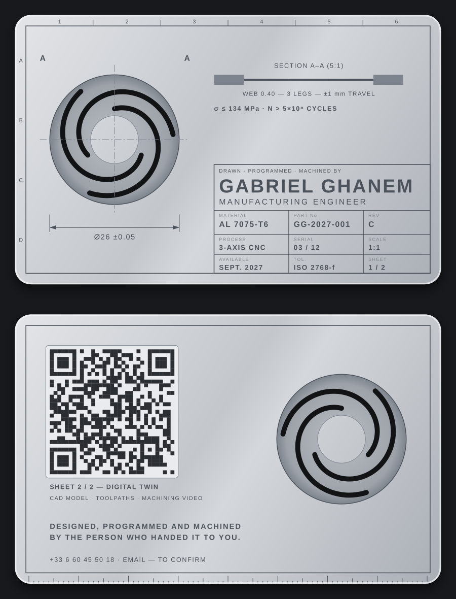
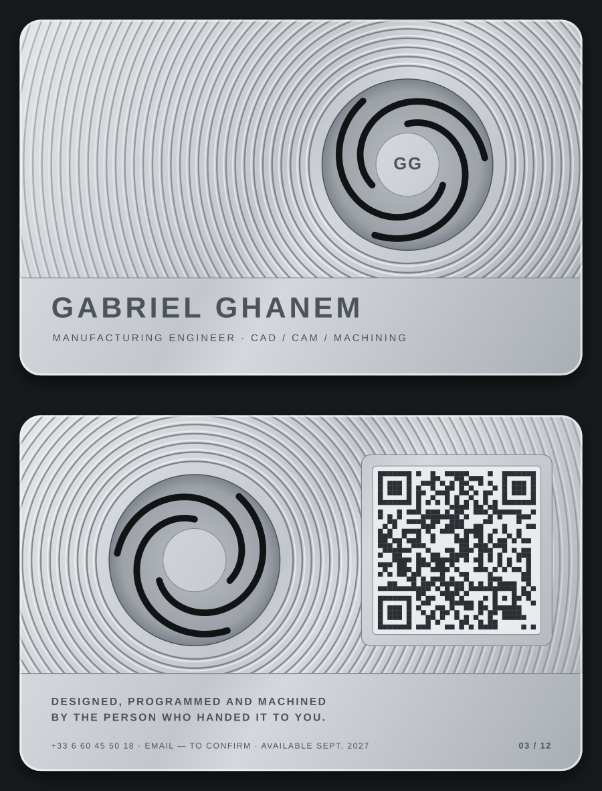
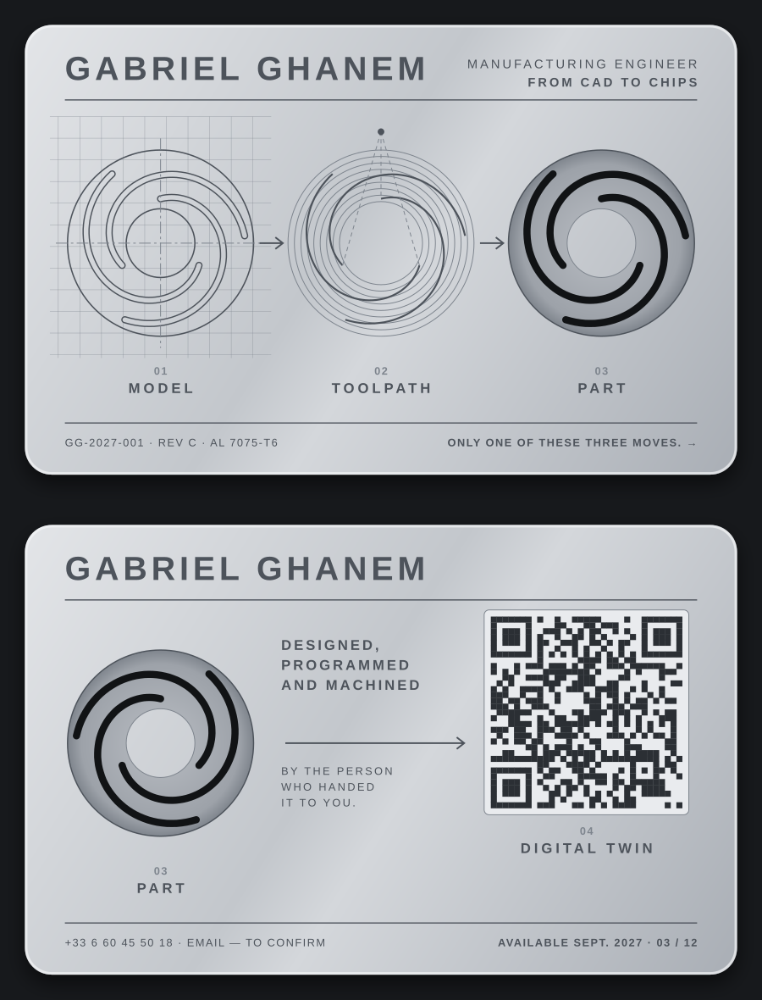

# CNC Business Card

A CNC-milled aluminium business card with a working orthoplanar spring, designed and machined by Gabriel Ghanem.

The card is a PLM demo in the hand: part number, revision, serial, and a QR code that opens its digital twin (CAD model, toolpaths, machining video).

## Spec (rev A, draft)

| | |
|---|---|
| Format | ISO ID-1, 85.60 × 53.98 mm, corner radius 3.18 mm |
| Stock | 2 mm aluminium plate, 7075-T6 for the flexure |
| Faces | Engraved recto and verso (flip with dowel-pin registration) |
| Flexure | Orthoplanar spring, 3 spiral legs, Ø26 mm pocket, web 0.40 mm centred in the thickness |
| QR | Points to the GitHub Pages site served from `docs/` (final short URL to be decided before engraving) |

## Flexure sizing (first pass)

`analysis/flexure_fatigue.py` treats each leg as a fixed-guided beam with a 1.4 knock-down for fillets, torsion and surface finish. Results are in `analysis/flexure_fatigue_results.txt`.

- Chosen point: 7075-T6, web 0.40 mm, leg length about 30 mm, leg width 2.6 mm.
- At ±1 mm travel the stress is about 134 MPa, under the 5×10⁸-cycle fatigue strength (159 MPa).
- At 3 mm of abuse it reaches about 400 MPa, under yield (503 MPa), so a finger should not bend it permanently.
- 6061-T6 yields under the same abuse case, so it is kept for cards without a flexure or for test cuts.
- To confirm by FEA (curved legs) and by cycling a test coupon before the batch.

## Layout

| Folder | Contents |
|---|---|
| `design/mockups/` | Concept mockups (SVG + PNG) and the script that generates them |
| `analysis/` | Flexure sizing |
| `cad/` | CAD exports (STEP, DXF) |
| `cam/` | Toolpaths, setup sheets, feeds and speeds |
| `docs/` | The page the QR code opens |
| `media/` | Photos and videos of the machining |

## Concepts under review

| A — Drawing sheet | B — Ripple | C — Digital thread |
|---|---|---|
|  |  |  |
